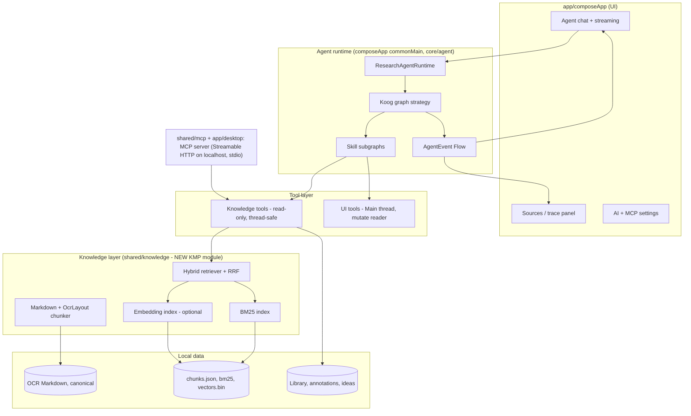
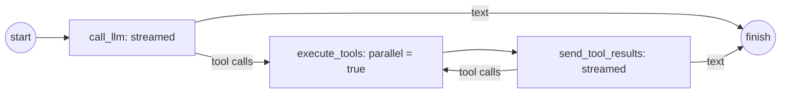
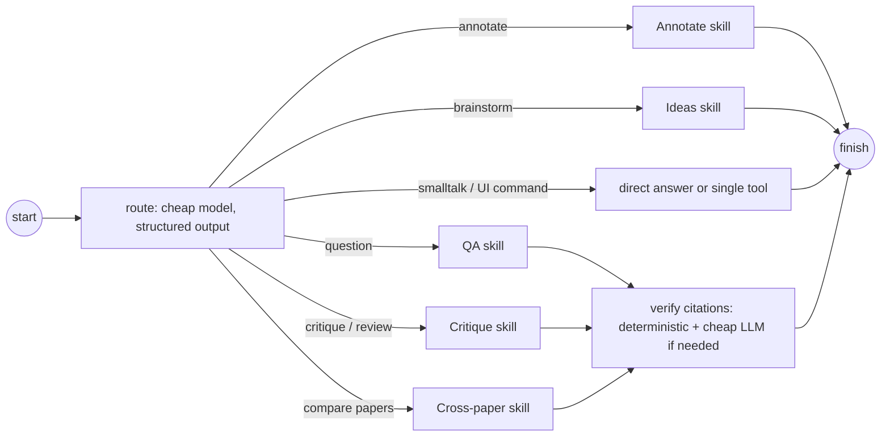
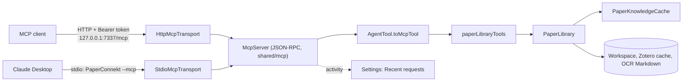

# PaperConnekt research agent architecture

Status: phases 0, 1 and 2 (core) are implemented; later phases are the plan. Target: Koog 1.3.0 (stable core) plus selected 1.3.0-beta modules.

## 1. Goals

| Goal | How |
| --- | --- |
| Cost-effective | Retrieve small cited chunks instead of injecting the paper into the prompt (up to 80k chars today), use a cheap model for routing and compression, compress history, and cache embeddings and responses locally |
| Serious and explainable | Every factual claim cites `[p.N §Section]` chunk IDs. A "Sources" panel shows what was retrieved, why (lexical or semantic score), and the token cost |
| Real agent | Koog graph strategy with routing, skills (subgraphs), parallel retrieval, verification, and persistence |
| Streaming | `requestLLMStreaming` → `Flow<AgentEvent>` → UI updates token by token, and tool calls and actions appear live |
| Parallel | Koog `parallel(...)` nodes plus structured coroutines and an LLM concurrency semaphore |
| App as an MCP server | The library tools are exposed on localhost over Streamable HTTP and stdio (desktop). It is opt-in, token-protected and read-only unless idea writes are allowed |
| Local-first | No backend. The index is rebuilt in memory and embeddings are local files. Semantic search uses the researcher's own provider key and can be turned off |

## 2. Layers



### 2.1 Knowledge layer (new `shared/knowledge` KMP module, no UI)

- **Canonical source:** paged OCR Markdown (`<!-- paperconnekt:ocr-page N -->`) plus `OcrLayout` boxes. Nothing replaces it.
- **Chunker:** splits by heading, then paragraph, with a target of about 350–600 tokens and a 1-paragraph overlap. It never crosses a page boundary without recording both pages. Tables, equations, and figure captions are atomic chunks.
- **`PaperChunk`:** `id = paperId:ocrVersion:ordinal`, `paperId`, `pages`, `sectionPath` (for example `3 Method > 3.2 Loss`), `kind` (text, table, equation, caption, references, abstract), `text`, `charRange`, `bbox?` (from `OcrLayout` → enables "jump and flash on the PDF").
- **Lexical index:** BM25 in pure Kotlin. It is fast, free, and deterministic. Section-title and abstract boosts. It handles exact terms (model names, numbers, symbols) better than vectors.
- **Vector index (implemented):** `EmbeddingProvider` is implemented in the app with Koog's `MistralAILLMClient` (`mistral-embed`, batched; preferred because the paper already went to Mistral for OCR) or `OpenAILLMClient` (`text-embedding-3-small`, one text per request, four in parallel). `PaperVectors.build` keys vectors by an FNV-1a hash of each chunk's text (section trail plus text) and embeds only hashes missing from the `VectorStore`, so each paper is embedded once and an edited paper re-embeds only changed chunks (a fraction of a cent per paper). It saves after every batch, so an interrupted run keeps its progress. Vectors are stored per `(paper, model)` as a little-endian float32 file (`VectorCodec`, `PCV1` header) in the private data directory; cosine top-k runs in memory over unit vectors.
- **Hybrid retriever (implemented):** `HybridPaperRetriever` takes a pool of BM25 and cosine results under the same page and kind filters and fuses them with reciprocal-rank fusion (k = 60, bibliography down-weighted unless requested). Each result keeps its keyword rank, meaning rank and similarity; the tool output shows "relevance 0.83 (keyword #2, meaning #1)" and the Sources list shows the same, which keeps retrieval explainable. If the query cannot be embedded it falls back to BM25. Dedup, neighbour merge and a token-budget packer remain future work.
- **Interfaces:** `PaperRetriever`, `VectorStore`, and `EmbeddingProvider` are our own interfaces, so `shared/knowledge` has no Koog dependency and the future MCP host or tests can supply their own. Koog `rag-base` and `rag-vector` (beta) are not needed.
- **Scope:** `RetrievalScope.Paper(id)`, `Papers(ids)`, or `Library`. The cross-paper index is built lazily for papers that already have OCR.
- **Index lifecycle:** the BM25 index is rebuilt in memory when the Markdown changes. Embedding starts in the background when the researcher sends a question, so vectors are usually ready by the agent's first search; retrieval waits at most 4 s and otherwise uses keywords. A failed embedding run is retried after 5 minutes. Query embeddings are cached in memory.

### 2.2 Tools

Tools keep the app's own `AgentTool` contract (name, description, typed `AgentToolParameter`s with enum options). One adapter maps it to Koog (`KoogAgentTool`) and a later one maps it to MCP, so each tool is written once and exposed to both without rewriting it per framework.

| Group | Tools | Thread | Exposed via MCP |
| --- | --- | --- | --- |
| Knowledge | `search_paper` (hybrid, returns cited chunks), `read_chunks`, `read_pages` (kept as fallback), `get_outline`, `get_figure`, `find_references`, `search_library`, `get_paper_metadata` | `Dispatchers.Default`, safe to parallelise | yes |
| Library and discovery | `search_openalex`, `list_annotations`, `list_ideas`, `read_idea` | IO | yes |
| Reader actions | `go_to_page`, `highlight_text`, `add_note`, `draw_*`, `update/delete_annotation`, `select_annotation` | Main | no (in-app only) |
| Idea board writes | `create_idea`, `update_idea` | Main | opt-in "write" scope |

Tool results are compact JSON or Markdown with chunk IDs. The model has to cite IDs, and a verifier checks them.

### 2.3 Agent runtime (Koog graph strategy)

**Implemented (phase 2 core).** `KoogResearchAgent` runs a custom `paper_research` graph instead of the built-in single-run strategy:



- Both model nodes stream (`requestLLMStreaming`), forward text deltas and provider token usage as `AgentEvent`s, and add the assembled reply to the prompt. If a provider cannot stream, the node falls back to a regular request.
- `nodeExecuteTools(parallel = true)` runs the independent tool calls of one step concurrently (for example several `search_paper` queries). Each tool call emits `ToolStarted`/`ToolFinished`.
- After the run, `Citations.verify` (in `shared/knowledge`) removes the hidden `[c12]` markers from the reply, checks every ID against the paper index, and reports unknown IDs. The UI shows them as a warning.

**Planned for later phases** (the router and skill subgraphs below are deferred: they add a model call per turn and are only worth it once multi-paper and critique skills exist):




- **Router node:** `nodeLLMRequestStructured<RoutePlan>` on the cheap model. It returns `{intent, subQueries[], scope, needsActions}`. It costs a few hundred tokens.
- **Retrieve step inside skills:** `parallel(...)` over subqueries (multi-query retrieval). Results are merged by RRF, packed into a token budget (for example 6k tokens), and appended as a tool result rather than a system prompt.
- **Skill subgraphs:** each one is `subgraph(tools = ...)` with its own small tool set and system addendum. Fewer tools per call means fewer schema tokens and better tool choice.
  - *QA:* retrieve, answer with citations, then tool loop (bounded to 6 iterations).
  - *Annotate:* retrieve exact passages, then highlight or note via UI tools (glyph anchoring stays as today).
  - *Ideas:* retrieve, then structured `IdeaDraft[]`, then `create_idea`.
  - *Critique:* parallel critics (method, evidence, novelty, limitations) on the cheap model, then a fold into a strong-model synthesis.
  - *Cross-paper:* a per-paper sub-agent (`AIAgentService.createAgentTool`) runs in parallel per paper with a semaphore, then the results are synthesised.
- **Verifier:** a deterministic check that every `[chunkId]` exists and that quoted text appears in the chunk. On failure, one cheap repair pass runs.
- **History:** `nodeLLMCompressHistory` (cheap model) between skills and when the token estimate is above the threshold. This replaces the "last 12 turns" folding. The existing `/compact` reuses it.
- **Model tiers:** `fast` (GPT-5-mini or Mistral Small) for routing, compression, and critics, and `strong` (the user's selected model) for final answers. Both are configurable.
- **Features installed:** `EventHandler` (→ UI events and usage accounting), `Tracing` (dev log), `Persistence` (checkpoints so long runs survive app restarts, desktop file storage), and the tokenizer (budgeting).
- **Caching:** `CachedPromptExecutor` with `FilePromptCache` for deterministic calls (routing, summaries of unchanged inputs). Embedding cache as above. The system prefix stays stable so provider-side prefix caching (OpenAI automatic) hits.

### 2.4 Streaming and events

**Implemented:** `ResearchAgent.stream(request): Flow<AgentEvent>` emits `StepStarted`, `TextDelta`, `ToolStarted(callId, name, arguments)`, `ToolFinished(callId, name, ok)`, `Usage(inputTokens, outputTokens)` and `Completed(text)`. `PaperAgentViewModel` collects it: the running bubble streams the text and lists live steps, retrieval tools report the passages they returned, and each reply stores its sources (cited passages first), steps and unverified citations. The collapsible Sources section under a reply opens the source page when clicked. Recorded usage uses provider token counts when the provider reports them, and estimates otherwise.

Planned additions:

`ResearchAgentRuntime.run(request): Flow<AgentEvent>` emits these events:
`Routed(intent)`, `Retrieval(query, results[score, method])`, `ToolStarted/Finished`, `TextDelta`, `ReasoningDelta?`, `Citation(chunkId)`, `Usage(tokens, cost)`, and `Completed/Failed`.
`PaperAgentViewModel` collects the flow on Main. The chat bubble streams. The Sources panel lists retrieved chunks, and clicking one jumps to its page and flashes its bbox.

### 2.5 Concurrency model

- One `CoroutineScope` per run, a child of `viewModelScope`. Cancellation (Stop) cancels the whole tree.
- `Dispatchers.Default` handles indexing, BM25, and cosine. `Dispatchers.IO` handles files and HTTP. `Dispatchers.Main` handles only UI tools.
- `LlmGate` semaphore (for example 4 concurrent requests per provider) handles rate limits. Embedding batches use backpressure.
- Knowledge stores are immutable snapshots that are swapped atomically (`MutableStateFlow`), so readers never lock.
- MCP requests run on the server's own scope and share the same immutable index snapshots.

### 2.6 App as an MCP server (implemented)

MCP clients (Claude Desktop, VS Code Copilot, Cursor, CLIs) can use the researcher's library with the same retrieval
the in-app agent uses: find papers, then read only the passages a task needs, with paper, page and chunk citations.



- **Protocol core (`shared/mcp`, KMP, no dependency besides kotlinx).** Koog's MCP integration is client-only and pins
  an older MCP Kotlin SDK, so the server is a small JSON-RPC 2.0 implementation of the tools subset of MCP:
  `initialize` (versions 2025-06-18, 2025-03-26, 2024-11-05), `ping`, `tools/list` (with `readOnlyHint` and
  `destructiveHint` annotations) and `tools/call`, plus batches and notifications. Tool failures are returned as
  `isError` results the model can read; protocol errors use the standard JSON-RPC codes. Requests run concurrently.
- **Transports (`shared/mcp` desktop).** `HttpMcpTransport` serves Streamable HTTP (JSON responses, no SSE) on the
  JDK HTTP server bound to 127.0.0.1 only. Every request needs `Authorization: Bearer <token>` (constant-time check),
  browser `Origin`s other than localhost are rejected (DNS rebinding), bodies are capped at 1 MB.
  `StdioMcpTransport` reads newline-delimited JSON-RPC on stdin and writes responses whole on stdout.
- **Tools (`app/composeApp` `feature/mcp`).** `paperLibraryTools` reuses the in-app `AgentTool` contract, and
  `AgentTool.toMcpTool` turns its typed parameters into a JSON Schema, so a tool is written once for Koog and MCP.
  `PaperLibrary` resolves paper IDs (local papers plus the cached Zotero library) to their OCR Markdown and indexes
  them through `PaperKnowledgeCache` under the reader's keys, so vectors embedded in the app are reused.

  | Tool | Purpose |
  | --- | --- |
  | `list_papers` | IDs, bylines and text status (ready, not converted, no PDF), optional keyword filter |
  | `get_paper` | Metadata, abstract and the paper map |
  | `get_outline` | Sections with pages and first chunk IDs |
  | `search_paper` | Hybrid (BM25 + embeddings when enabled) or exact search in one paper, with page/section/kind filters |
  | `read_chunks` | Full text of cited chunks, with optional neighbours |
  | `read_pages` | Up to five pages, as a fallback |
  | `search_library` | BM25 over every converted paper in parallel (4 at a time, up to 60 papers), best passages per paper |
  | `add_idea_note` | Write scope only: adds a note to a paper's Idea Board |

- **Host (`app/desktop`).** `DesktopMcpHost` implements the common `McpHost` contract: it starts the HTTP transport
  when Settings → AI tools (MCP) is on, restarts it when the port or token changes, and keeps the last 200 requests
  (tool, client, duration, arguments or error, and embedding calls with their token estimate) for the Settings log.
  `PaperConnekt --mcp` runs the same `PaperConnektMcpRuntime` headless over stdio; it reads the workspace at launch,
  never writes it, sends logs to stderr and exits unless the user enabled MCP in the app.
- **Security and consent.** Off by default. The token is 32 random bytes from `SecureRandom`, stored in `SecretStore`
  (`SecretKey.MCP_TOKEN`) and can be regenerated. Tools are read-only unless "Allow adding idea notes" is on; the
  switch is read on every `tools/list`, so it applies immediately. No reader or UI action is exposed.
- **Idea Board sync.** Notes added through the HTTP server emit `IdeaNoteChanges`, so an open Idea Board reloads.
  The stdio process cannot notify the app; its notes appear when the paper is reopened.
- **Limits.** Only papers converted to text in the reader are searchable, and only the Zotero library selected in the
  app is visible. Embeddings for a paper are computed only when the client searches it and semantic search is on.
- **Later.** An `ask_paperconnekt_agent` tool (agent as a tool), resources for paper Markdown, and SSE streaming.

#### Connecting a client

Settings → AI tools (MCP) copies these snippets with the real endpoint and token:

```jsonc
// VS Code (.vscode/mcp.json)
{ "servers": { "paperconnekt": { "type": "http", "url": "http://127.0.0.1:7337/mcp",
  "headers": { "Authorization": "Bearer <token>" } } } }

// Cursor (~/.cursor/mcp.json)
{ "mcpServers": { "paperconnekt": { "url": "http://127.0.0.1:7337/mcp",
  "headers": { "Authorization": "Bearer <token>" } } } }

// Claude Desktop (claude_desktop_config.json): stdio, no token needed
{ "mcpServers": { "paperconnekt": { "command": "/path/to/PaperConnekt", "args": ["--mcp"] } } }
```

## 3. Module placement (respects AGENTS.md)

| Module | New or changed content |
| --- | --- |
| `shared/knowledge` (new, KMP) | chunk model, chunker, BM25, vector math, hybrid retriever, index store contracts |
| `shared/domain` | `PaperChunk`, `Citation`, `RetrievalScope` models (if shared with plugins) |
| `app/composeApp` `core/agent` | runtime, strategy, skills, tools, events, model tiers |
| `app/composeApp` feature/assistant | ViewModel streaming, Sources panel, settings UI |
| `shared/mcp` (new, KMP) | MCP JSON-RPC server core; desktop stdio and Streamable HTTP transports |
| `app/composeApp` feature/mcp | `PaperLibrary`, library tools, `AgentTool` → MCP adapter, `McpHost` contract, Settings section |
| `app/desktop` | `DesktopMcpHost`, `--mcp` stdio launcher, file-backed index store, persistence provider |
| `app/android` | Android index store (app files dir). No MCP server |
| `plugin/native-plugins/common` | can reuse `shared/knowledge` for plugin search later |
| `docs/` | `ai-agent-architecture.md`, MCP setup guide, README section |

## 4. Cost estimate (typical question on a 30-page paper)

| | Today | Proposed |
| --- | --- | --- |
| Context per question | ≈ 20k tokens of paper + tools | ≈ 1.5k system + 4–6k retrieved |
| Extra calls | — | router plus verifier on a cheap model (about 1k tokens) |
| One-time | OCR | OCR plus embeddings (well under one cent per paper; recorded as "Paper embeddings" usage) |
| Expected saving | — | **≈ 60–80 % input tokens per turn**, growing with paper length and conversation length |

## 5. Phased roadmap (each phase can be merged on its own)

0. **Koog 1.3 upgrade**, keeping the single `AgentTool` contract with Koog and MCP adapters. No behaviour change.
1. **Knowledge core (implemented):** `shared/knowledge` with `MarkdownChunker`, BM25 `PaperIndex` and the `PaperRetriever` extension point; `search_paper` (relevant and exact modes), `read_chunks` and `get_outline` with citations; a paper map instead of the full text for papers over 24,000 characters; retrieved passages for annotation AI actions. The index is in memory (`PaperKnowledgeCache`) and rebuilt from the Markdown; a persisted store arrives with embeddings in phase 3.
2. **Graph strategy and streaming (core implemented):** `paper_research` graph with streamed model nodes and parallel tool execution, `AgentEvent` flow, streaming chat with live steps, deterministic citation verifier, Sources section, real token usage. Deferred: cheap-model router, skill subgraphs, `nodeLLMCompressHistory`, bbox flash on a source.
3. **Embeddings (implemented):** automatic when a Mistral or OpenAI key exists, with a Settings → Paper search switch; incremental, content-hashed vectors stored on device; hybrid BM25 + cosine retrieval with RRF in `search_paper` and annotation AI actions; ranks shown in tool output and Sources; embedding usage and cost in the dashboard. Deferred: embedding progress in the reader, library-wide vectors (phase 5).
4. **MCP server (implemented):** `shared/mcp` protocol core with Streamable HTTP and stdio transports; library-level tools (`list_papers`, `get_paper`, `get_outline`, `search_paper`, `read_chunks`, `read_pages`, `search_library`, opt-in `add_idea_note`) over `PaperLibrary`; desktop host with Settings (switch, port, token, client snippets, request log) and `PaperConnekt --mcp`. Deferred: agent-as-a-tool, MCP resources, SSE.
5. **Parallel and multi-paper work:** parallel critics, cross-paper sub-agents, library-wide search, persistence checkpoints.
6. **Quality:** a small evaluation set (questions to expected pages), a retrieval hit-rate report, and documentation.

## 6. Deliberately not doing

- Vector-only RAG, because exact terms and numbers fail without the lexical side.
- Removing `read_pages`, because the agent still needs a deterministic fallback.
- A remote vector database or backend.
- Automatic library-wide embedding without consent. Only papers the researcher asks the agent about are embedded.
- Exposing UI-mutating tools over MCP.
- Coupling the core to beta Koog RAG and planner APIs. They stay behind our interfaces.
